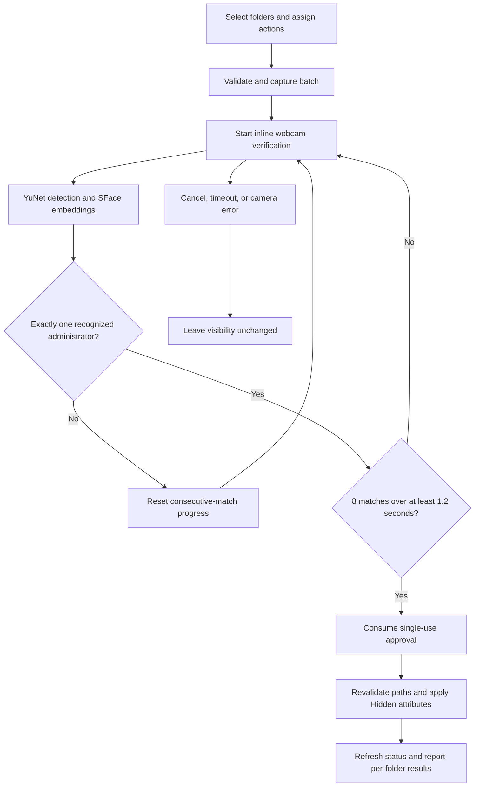

# FaceLocker

### Local Biometric Verification for Windows Folder Visibility Control


FaceLocker is a Windows 11 desktop application that uses local webcam-based face recognition to approve folder visibility changes. Users can manage multiple folders, assign hide or unhide actions individually, and execute a batch after administrator verification. An English interface combines rounded controls, light and dark themes, and an inline webcam panel.

Developed by **Pooya Haji Sadeghi**.

This repository contains the application source, first-run installer, Windows executable build scripts, tests, and project documentation. It does not include a prebuilt executable, enrolled identities, or model weights.

## Capabilities

| Capability | Implementation |
| --- | --- |
| Local face recognition | YuNet detects faces; SFace extracts embeddings; cosine similarity identifies enrolled people on CPU. |
| Multiple identity enrollment | Register named profiles, replace enrollment samples, rename identities, and import a legacy database. |
| Multiple-face preview | Detect and label multiple faces in the webcam view. Folder approval requires exactly one recognized administrator. |
| Folder selection | Browse to add folders to a persistent list; select individual rows or the entire list. |
| Batch visibility control | Hide selected folders, unhide selected folders, or assign different actions within one batch. |
| Verification for both actions | A fresh face check is required before every hide or unhide batch, including when Admin is already unlocked. |
| Administrator management | Face-verified access to enrollment and owner management; leaving Admin relocks the session. |
| Inline verification | Pending action, camera preview, and approval progress appear in the right-hand panel of the main window. |
| Modern desktop interface | English-only menus, light/dark appearance, rounded cards, and persistent theme settings. |
| Managed installation | A launcher prepares Python 3.10 x64, an isolated environment, pinned packages, and recognition models at first run. |
| Startup recovery | Single-instance handling, visible-window readiness checks, retryable setup errors, and diagnostic logs. |

**Scope:** FaceLocker changes the Windows directory Hidden attribute. It does not encrypt files or enforce filesystem access control. Recognition has no liveness or anti-spoofing check. Use it as a local visibility-management project, not a substitute for operating-system security.

## Technology stack

| Technology | Role | Version / format |
| --- | --- | --- |
| Python | Application, installer, and build tooling | 3.10, x64 |
| OpenCV | Webcam capture, detection, alignment, and recognition | `opencv-python==4.10.0.84` |
| YuNet | Face detection | `face_detection_yunet_2023mar.onnx` |
| SFace | Face embedding extraction | `face_recognition_sface_2021dec.onnx` |
| NumPy | Embedding normalization and cosine matching | `1.26.4` |
| CustomTkinter / Tk | Desktop interface and theme support | `5.2.2` / Python Tcl/Tk |
| Pillow | Image conversion and presentation | `11.3.0` |
| Win32 API via ctypes | Read and update directory attributes | `GetFileAttributesW`, `SetFileAttributesW` |
| JSON | Local enrollment, folder, and settings persistence | Versioned `state.json` |
| PyInstaller | Windowed single-file launcher packaging | `6.22.3` |
| unittest / GitHub Actions | Regression tests and manual Windows EXE builds | Repository workflows |

## Application workflow



Verification allows up to 30 seconds. Rejected observations reset progress. Unknown identities, ambiguous matches, multiple faces, and undersized faces cannot approve an operation. The captured batch remains fixed during verification. Windows permission failures can produce partial success; successful changes are retained rather than rolled back.

## Installation and execution

### End-user executable

1. Obtain `FaceLocker.exe` from a build of this repository.
2. Open the executable on Windows 11 x64.
3. Allow first-run setup to prepare the runtime, packages, and models.
4. Register the first identity in **Admin**, then add folders in **Folders**.

First-run setup needs internet. It reuses a compatible Python installation or installs a private Python 3.10.11 x64 runtime after checking the pinned installer SHA-256. Healthy subsequent launches reuse the installation without package or model downloads. Webcam inference stays local.

### Run from source

Install Python **3.10 x64** with Python Launcher and Tcl/Tk, extract the complete repository, and run:

```bat
scripts\run.bat
```

Source mode prepares the same managed installation and enrollment store as the executable. Keep Python files in `src/` and BAT files in `scripts/`.

### Build the Windows executable

On Windows with Python 3.10 x64:

```bat
scripts\build_exe.bat
```

Output: `dist\FaceLocker.exe`. Build diagnostics: `logs\build.log`.

Alternatively, use **Actions > Build Windows EXE > Run workflow** and download the `FaceLocker-Windows-x64` artifact. The workflow builds an executable; it does not publish a release automatically.

See [Installation and troubleshooting](docs/INSTALLATION.md) and [Quick start](docs/QUICK_START.md).

## Architecture

| Module | Responsibility |
| --- | --- |
| `src/app.py` | Navigation, folder selection, enrollment sessions, and inline verification UI |
| `src/ui.py`, `src/strings.py` | Shared themed widgets and English interface messages |
| `src/vision.py` | Model setup, webcam capture, face detection, alignment, and embeddings |
| `src/database.py` | Similarity matching, identity validation, migrations, and atomic state writes |
| `src/locker.py` | Path validation, batch operations, Win32 attributes, and single-use authorization |
| `src/launcher.py`, `src/bootstrap.py` | Setup UI, runtime provisioning, environment repair, and child-process launch |
| `src/instance.py`, `src/window_lifecycle.py` | Single-instance behavior and visible-window readiness |
| `src/runtime_entry.py`, `src/start_source.py` | Runtime entry and source-mode bootstrap |
| `src/build_exe.py` | PyInstaller launcher build |

Matching uses normalized embeddings and the mean cosine score of up to three best enrollment samples per identity. Defaults are a similarity threshold of **0.45**, an ambiguity margin of **0.05**, and **10 enrollment samples**. Similarity scores are not calibrated probabilities. See [Architecture and verification](docs/ARCHITECTURE.md).

## Repository layout

| Path | Contents |
| --- | --- |
| `src/` | All application and build Python modules |
| `scripts/` | Windows launch, build, and diagnostic BAT scripts |
| `requirements/` | Pinned runtime and build dependencies |
| `tests/` | Logic, bootstrap, structure, startup, and GUI regressions |
| `docs/` | Installation, architecture, GitHub setup, and showcase documentation |
| `docs/assets/` | Three portfolio and publication posters |
| `docs/previews/` | Application UI preview images |
| `.github/workflows/` | Windows executable build automation |

## Local data and behavior

The managed installation lives under `%LOCALAPPDATA%\FaceLocker`. Application code, Python environment, models, data, and logs are stored separately. Enrollment embeddings, administrator name, folder paths, camera settings, and theme are persisted locally in `data\state.json`.

No face images or video recordings are saved by the recognition pipeline. Embeddings and settings are **unencrypted**. Models are downloaded during setup; live recognition does not upload webcam frames or require an API key.

Only each selected directory's Hidden bit changes. Other attributes are preserved. Removing a folder from the list does not delete it or change its visibility. Closing FaceLocker does not automatically hide folders. Explorer can display hidden folders when **Hidden items** is enabled.

Drive roots, protected system locations, application paths and their ancestors, and redirected paths are rejected. A batch that hides a parent while revealing its child is rejected.

## Testing

With Python 3.10 and runtime dependencies installed, run from the repository root:

```powershell
python -m pip install -r requirements/requirements.txt
python -m unittest discover -s tests -v
```

Desktop GUI checks are separate:

```powershell
python tests/gui_smoke.py
python tests/window_regression.py
```

GUI checks use simulated camera and attribute operations. Unit tests cover matching, migrations, authorization, cancellation, partial failures, deployment, and startup behavior. Physical webcam behavior, native Windows permissions, and the built EXE still require testing on Windows 11.

## Project showcase

The three posters are promotional compositions based on application screenshots. They illustrate the project and are distinct from the automated UI previews.

| LinkedIn showcase | Portfolio case study |
| --- | --- |
|  |  |

[View all visual assets](docs/SHOWCASE.md).

## Developer and license

**Pooya Haji Sadeghi** — FaceLocker developer.

Application source is available under the [MIT License](LICENSE). Third-party packages and model weights retain their respective upstream licenses. Review those licenses when redistributing dependencies or models.

For repository description, technical topics, and upload instructions, see [GitHub setup](docs/GITHUB_SETUP.md).
