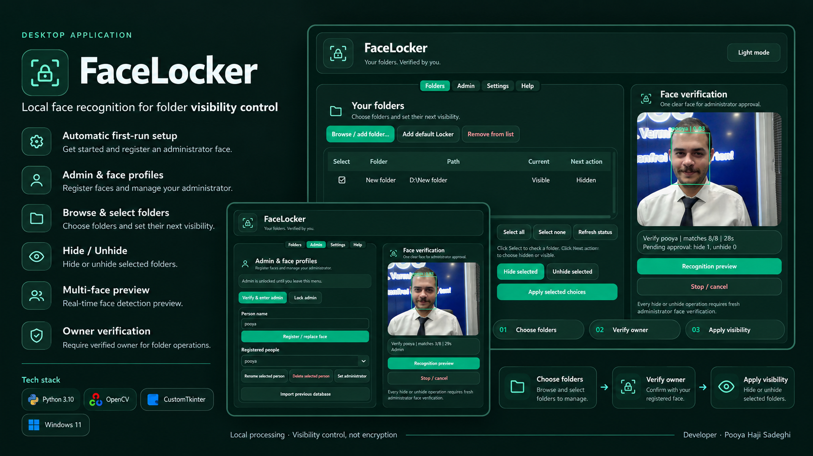
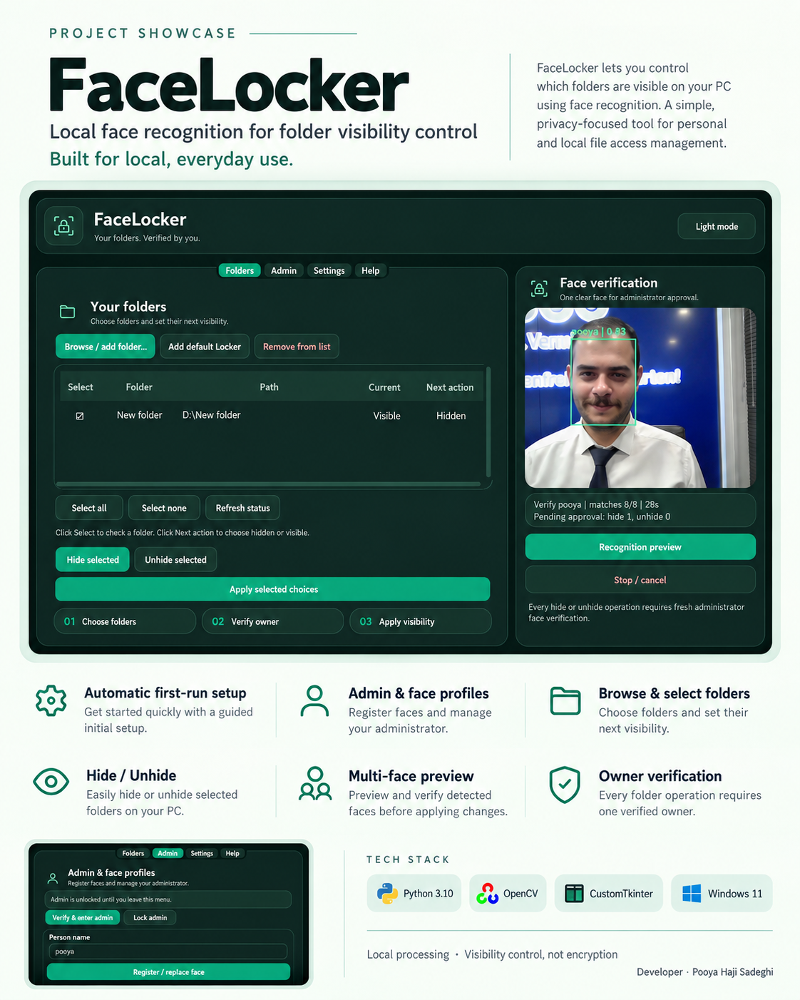
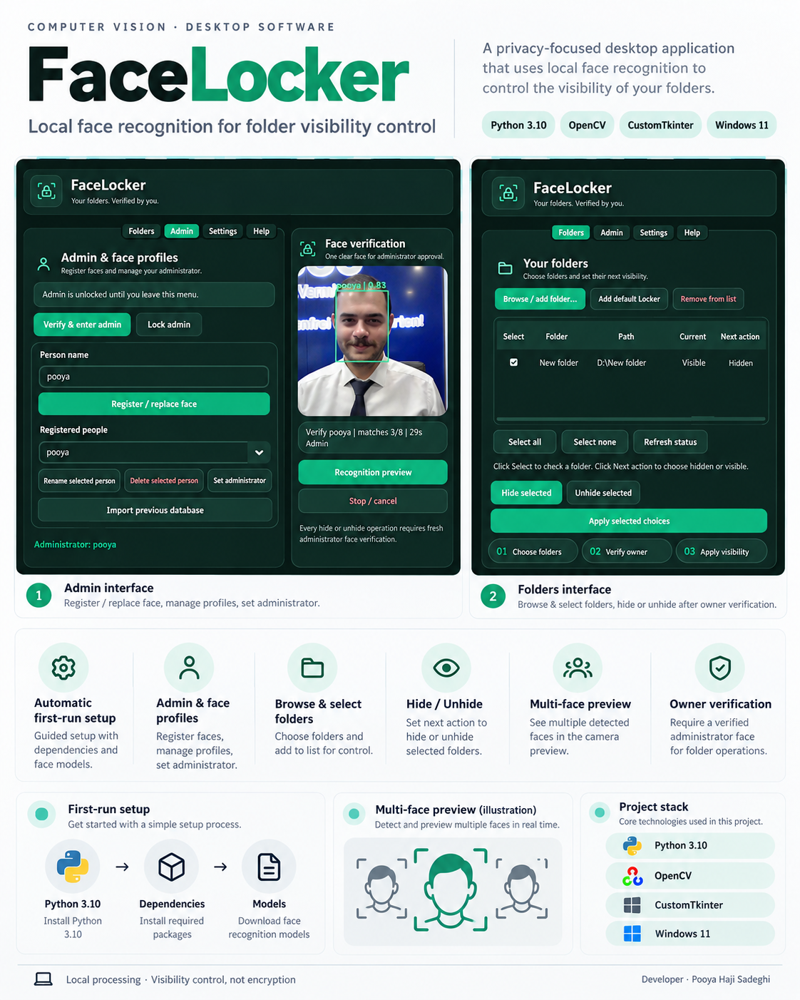
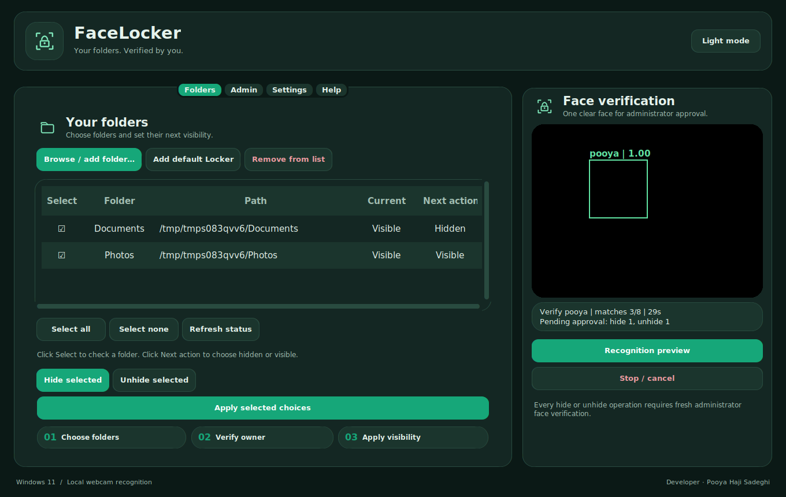

# Project Showcase

Developer: **Pooya Haji Sadeghi**.

These are the final three promotional posters created for GitHub, LinkedIn, and portfolio presentation. They use application screenshot material in designed compositions. Product behavior and technical scope are documented in the repository README.

## GitHub project cover

## LinkedIn showcase

## Portfolio case study

## Application preview

